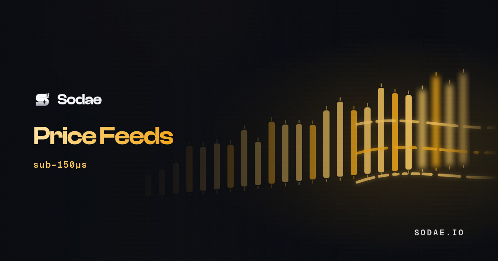

<Frame>
  
</Frame>

Price Feeds decodes every transaction and turns anything that moves a price into a price update: a swap on any pool, an oracle program writing a new value. Coverage follows from decoding rather than a curated list, so a new pool is priced from its first swap.

One gRPC service carries two streams:

- **`SubscribePrices`** sends the USD price of the tokens you list whenever one of them moves.
- **`SubscribePools`** sends a tick for every price change on the pools you choose.

| | |
|---|---|
| Endpoint | `http://ams.feeds.sodae.io:10401` (plaintext HTTP/2) |
| TLS endpoint | `https://ams.feeds.sodae.io:443` |
| Service | `soda.prices.v1.PriceFeed`, defined in [`price_feed.proto`](https://github.com/sodae-io/sodae-docs/blob/main/examples/proto/price_feed.proto) |
| Authentication | `x-token` metadata |
| Plans | [Price Feeds seat](/pricing#price-feeds), $250 / month, or [Per GB](/pricing#price-feeds) at $0.05 per GB. [Free trial](/pricing#free-trials) on request |
| IPs | 1 on the seat, any number on Per GB |
| Coverage | Every token, every pool |

## Why decode instead of reading an oracle

An oracle publishes a settled value after consensus, so every reader sees it at the same moment. Decoding the transaction stream gives you the move as it lands, including swaps the oracle has not reflected yet. Swap prices and oracle updates arrive in the same feed.

## Getting access

<Steps>
  <Step title="Claim a trial or buy a plan">
    Press **Claim free trial** on the Price Feeds page, or add the seat or Per GB data under **Plans** and check out. Trial requests are reviewed before they start. See [Paying](/pricing#paying).
  </Step>
  <Step title="Bind your server's IP (seat only)">
    The seat admits one IP. Add your server's public IP under **Plans → Allowed IPs**. Per GB works from any IP.
  </Step>
  <Step title="Connect">
    Point a gRPC client at the endpoint and send your [API key](/authentication) as `x-token` metadata. The endpoints and your key are on the Price Feeds page.
  </Step>
</Steps>

On Per GB, the bytes the stream delivers count against your data, as on [Yellowstone gRPC](/yellowstone/overview). The seat has no data cap.

## API

```protobuf price_feed.proto
syntax = "proto3";

package soda.prices.v1;

service PriceFeed {
  rpc SubscribePools(SubscribePoolsRequest) returns (stream PoolUpdate);
  rpc SubscribePrices(SubscribePricesRequest) returns (stream PriceUpdate);
}

message SubscribePoolsRequest {
  repeated string pools = 1;
  repeated string mints = 2;
  repeated string dex = 3;
  bool all = 4;
  uint64 interval_ms = 5;
  uint32 max_ticks_per_update = 6;
}

message SubscribePricesRequest {
  repeated string mints = 1;
  int64 min_change_bps = 2;
}

message PoolTick {
  string pool = 1;
  string dex = 2;
  string base_mint = 3;
  string quote_mint = 4;
  double price = 5;
  double base_reserve_ui = 6;
  double quote_reserve_ui = 7;
  uint32 fee_bps = 8;
  uint64 slot = 9;
  optional uint64 tx_index = 10;
  int64 updated_at_ms = 11;
  optional string signature = 12;
}

message PoolUpdate {
  int64 ts_ms = 1;
  uint64 slot = 2;
  uint32 dropped = 3;
  uint64 lagged_batches = 4;
  repeated PoolTick ticks = 5;
}

message PriceTick {
  string mint = 1;
  double usd_price = 2;
  uint32 decimals = 3;
  uint64 slot = 4;
  int64 change_bps = 5;
  int64 updated_at_ms = 6;
}

message PriceUpdate {
  int64 ts_ms = 1;
  uint64 slot = 2;
  repeated PriceTick prices = 3;
}
```

Both calls are server streams: send one request, then read updates until you close the call. To change what you follow, open a new call.

Tokens can be given as mint addresses or as these symbols, in any letter case: `SOL` (or `WSOL`), `USDC`, `USDT`, `JUP`, `BONK`, `JITOSOL`, `MSOL`. Responses always carry mint addresses.

### SubscribePrices

| Field | Description |
|---|---|
| `mints` | Required. Tokens to watch, up to 100 |
| `min_change_bps` | Send a token again only after it has moved at least this many basis points from the last price you received. `0`, the default, sends every move |

The first update carries the current price of every requested token that has one, so you do not wait for its next trade. After that, an update arrives whenever a token you watch moves.

| Field | Meaning |
|---|---|
| `mint` | Token mint address |
| `usd_price` | USD per whole token |
| `decimals` | The token's decimals |
| `slot` | Chain slot the price was computed at |
| `change_bps` | Move since the token's previous published price, in basis points |
| `updated_at_ms` | When the price was computed, in Unix milliseconds |

#### How the price is made

The price is what a small swap would realise right now. Price Feeds routes $10 of USDC into the token across every pool it decodes and inverts the result, so the number includes pool fees and the price impact of that size. If $10 finds no sound route, it tries $100, then $1,000. USDC is fixed at exactly $1.00.

It is not an oracle read or a time-weighted average, and it moves as soon as a pool that prices the token trades.

### SubscribePools

| Field | Description |
|---|---|
| `pools` | Pool addresses, up to 500 |
| `mints` | Every pool with this token on either side, up to 200 |
| `dex` | Venues, written exactly as under [Venues](#venues) |
| `all` | `true` for every pool |
| `interval_ms` | `0` sends each update as it lands. `100` to `5000` batches: within each window, repeat updates to one pool collapse to the latest |
| `max_ticks_per_update` | Ticks per update, `1` to `1000`, default `200`. Past the cap the deepest pools are kept and `dropped` counts the rest |

How the filters combine:

- `pools` and `mints` choose pools: a pool in your `pools` list, or a pool with one of your `mints` on either side.
- `dex` narrows that choice to the listed venues.
- `dex` on its own streams every pool on those venues.
- `all: true` streams every pool, narrowed by `dex` if you give it.

| Field | Meaning |
|---|---|
| `pool`, `dex` | The pool address and its venue |
| `base_mint`, `quote_mint` | The pool's two tokens |
| `price` | Quote token per base token after the latest update to the pool |
| `base_reserve_ui`, `quote_reserve_ui` | Pool reserves in whole tokens |
| `fee_bps` | The pool's swap fee |
| `slot`, `tx_index` | Where the update landed. `tx_index` is left out when unknown |
| `signature` | The transaction that set the price. Left out when unknown |
| `updated_at_ms` | When the tick was produced, in Unix milliseconds |
| `dropped` | Ticks left out of this update by `max_ticks_per_update` |
| `lagged_batches` | Set when your client fell behind and batches were skipped |

With `interval_ms: 0`, a subscription on SOL alone carries several hundred updates a second at busy times. Set an interval if you would rather receive fewer, larger updates.

## Examples

Download [`price_feed.proto`](https://github.com/sodae-io/sodae-docs/blob/main/examples/proto/price_feed.proto) next to your code.

<CodeGroup>

```typescript TypeScript
import * as grpc from "@grpc/grpc-js";
import * as protoLoader from "@grpc/proto-loader";

const definition = protoLoader.loadSync("price_feed.proto", { longs: String, defaults: true });
const { PriceFeed } = (grpc.loadPackageDefinition(definition) as any).soda.prices.v1;

const client = new PriceFeed("ams.feeds.sodae.io:443", grpc.credentials.createSsl());
const metadata = new grpc.Metadata();
metadata.set("x-token", process.env.SODAE_TOKEN!);

const prices = client.SubscribePrices({ mints: ["SOL", "JUP"], minChangeBps: 1 }, metadata);
prices.on("data", (update: any) => {
  for (const p of update.prices) console.log(update.slot, p.mint, p.usdPrice);
});
prices.on("error", (err: grpc.ServiceError) => console.error(err.code, err.details));
```

```python Python
# pip install grpcio grpcio-tools
# python -m grpc_tools.protoc -I. --python_out=. --grpc_python_out=. price_feed.proto
import os

import grpc
import price_feed_pb2 as pb
import price_feed_pb2_grpc as rpc

channel = grpc.secure_channel("ams.feeds.sodae.io:443", grpc.ssl_channel_credentials())
stub = rpc.PriceFeedStub(channel)
metadata = [("x-token", os.environ["SODAE_TOKEN"])]

request = pb.SubscribePoolsRequest(mints=["SOL"], dex=["Whirlpool"], interval_ms=250)
for update in stub.SubscribePools(request, metadata=metadata):
    for t in update.ticks:
        print(update.slot, t.dex, t.pool, t.price)
```

```bash grpcurl
grpcurl -proto price_feed.proto -H "x-token: $SODAE_TOKEN" \
  -d '{"mints":["SOL","JUP"]}' \
  ams.feeds.sodae.io:443 soda.prices.v1.PriceFeed/SubscribePrices
```

</CodeGroup>

For the plaintext endpoint, connect to `ams.feeds.sodae.io:10401` with insecure credentials: `grpc.credentials.createInsecure()` in TypeScript, `grpc.insecure_channel` in Python, or `-plaintext` with grpcurl.

## Errors

Access errors are the same as on the other gRPC products: `UNAUTHENTICATED`, `NOT_ENTITLED`, `IP_NOT_ALLOWED` and `QUOTA_EXCEEDED`. See [Errors](/errors). The service itself returns:

| Status | Message | Cause |
|---|---|---|
| 3 `INVALID_ARGUMENT` | `prices needs mints` | `SubscribePrices` without `mints` |
| 3 `INVALID_ARGUMENT` | `pass pools, mints, dex, or all=true` | `SubscribePools` without a filter |
| 3 `INVALID_ARGUMENT` | `mint list too large`, `pool list too large` | More than 100 `mints` on prices, 200 on pools, or 500 `pools` |
| 3 `INVALID_ARGUMENT` | `invalid mints: …`, `invalid pools: …`, `unknown dex: …` | An entry that is not an address, a listed symbol or a venue name. The message names it |
| 8 `RESOURCE_EXHAUSTED` | `client too slow` | Your client fell behind three times within 60 seconds. Read faster or set `interval_ms` |
| 8 `RESOURCE_EXHAUSTED` | `server price watch set is full`, `too many streams` | Server capacity. Retry after a short wait |

## Venues

`dex` on a tick is one of these names, and the `dex` filter accepts them written exactly as here:

1DEX, Alphaq, Aquifer, Archer, BisonFi, BisonFiPredict, Bonkswap, Boop, Byreal, CreatorFun, DefiTuna, Denali, Deriverse, DexLab, Dynamic Bonding Curve, Exponent CLMM, FluxBeam, Flint, Gavel, GoonFi V2, Goonfi, GooseFX GAMMA, Guacswap, Hadron, HeavenAmm, HumidiFi, Hylo Exchange, Invariant, Jupiter Lend Earn, Jupiter Perpetuals, JupLend AMM, Kipseli, Manifest, Mayhem, Mercurial, MetaDAO, Meteora, Meteora DAMM v2, Meteora DLMM, Moonit, MoonPay, Obric V2, Obsidian, Omnipair, OpenbookV2, Orca V1, PancakeSwap, Perena, Phoenix, PrintDex, Pump.fun, Pump.fun Amm, Quantum, Quay, Raydium AMM, Raydium CLMM, Raydium CP, Raydium Launchlab, Riptide, Saber, Sanctum, Sanctum Infinity, Saros, Saros DLMM, Scorch, SolFi, SolFi V2, Stabble Stable Swap, Stabble Weighted Swap, StepN, TaurusFi, TesseraV, TokenMill, VaultLiquidUnstake, WhaleStreet, Whirlpool, ZeroFi and Zora.
